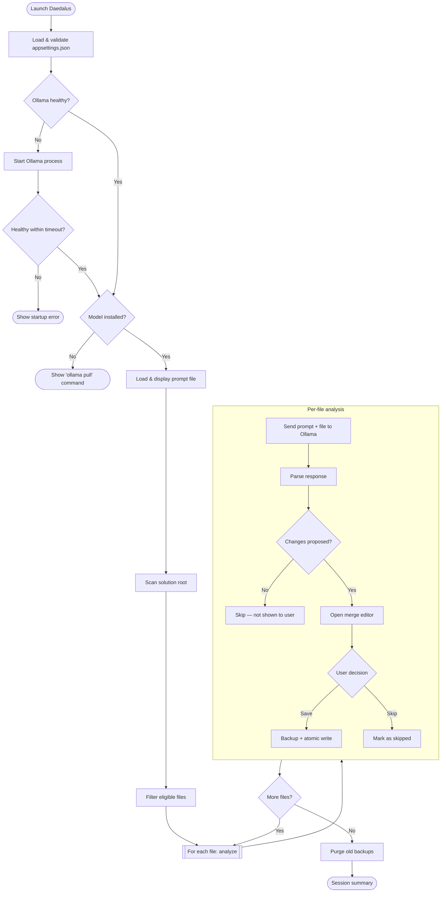
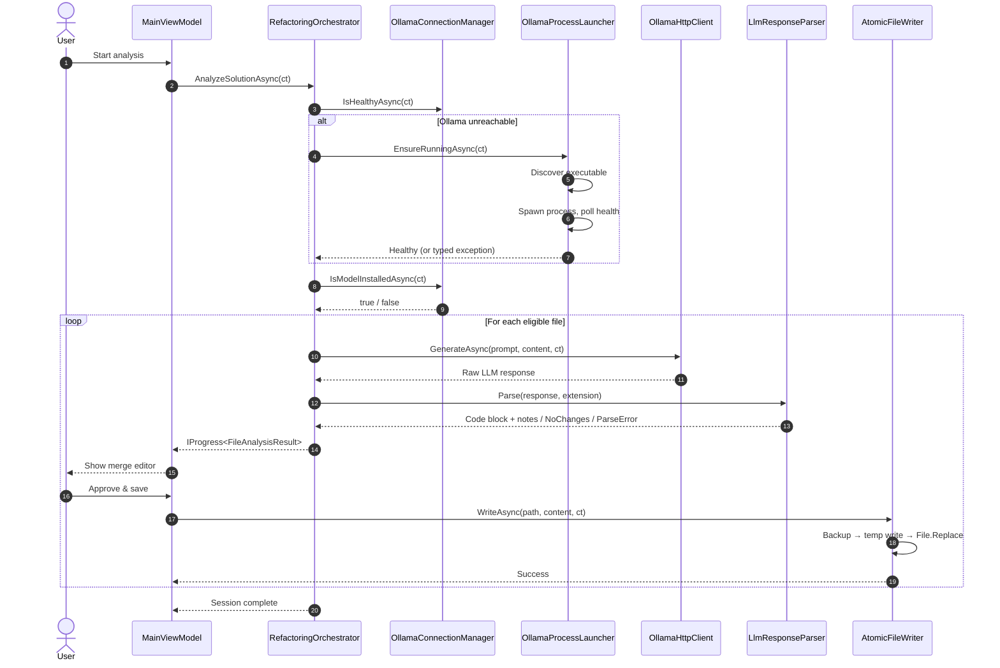


# Daedalus

**Offline C# solution inspector and refactoring tool, powered by local LLMs.**

[](LICENSE)
[](https://dotnet.microsoft.com/)
[]()

Daedalus analyzes an entire C# solution using a **locally-running LLM** (via [Ollama](https://ollama.com)) and proposes targeted refactorings for `.cs`, `.xaml`, `.csproj`, and `appsettings.json` files. Every change is presented in a three-panel merge editor for human review before it is written to disk.

**Zero cloud. Zero telemetry. Zero automatic overwrite.**

---

## Table of Contents

- [Why Daedalus](#why-daedalus)
- [Features](#features)
- [Requirements](#requirements)
- [Installation](#installation)
- [Usage](#usage)
- [Configuration](#configuration)
- [How it works](#how-it-works)
- [Architecture](#architecture)
- [Roadmap](#roadmap)
- [Contributing](#contributing)
- [License](#license)

---

## Why Daedalus

Cloud-based code review tools require you to upload your source code to a third party. For many teams — especially those working on proprietary or regulated code — that is a non-starter. Daedalus runs entirely on your machine, using an LLM served by [Ollama](https://ollama.com) on `localhost`. Your code never leaves your computer.

Unlike static analyzers, Daedalus uses a language model that understands semantic context: it can refactor a C# file using modern language features, flag business logic leaking into XAML code-behind, verify project file hygiene, and catch hardcoded secrets in configuration — all in a single pass.

---

## Features

- **Solution-wide analysis** of `.cs`, `.xaml`, `.csproj`, and `appsettings.json` files.
- **Context-aware prompting** — different rules per file type, driven by a user-supplied prompt.
- **Three-panel merge editor** — original, AI proposal, and editable final result, with synchronized scrolling.
- **Human-in-the-loop** — no file is ever overwritten without explicit approval.
- **Atomic writes with session backups** — crash-safe saves; every modified file is backed up before being replaced.
- **Local-only operation** — talks only to your configured Ollama endpoint.
- **Structured logging** — Serilog with daily rotation, retained for 7 days.
- **Fail-fast configuration** — all settings validated at startup with a complete error report.

---

## Requirements

| Requirement | Details |
|---|---|
| OS | Windows 10 (build 19041+) or Windows 11 |
| Runtime | .NET 8 Desktop Runtime (bundled in the self-contained release) |
| LLM engine | [Ollama](https://ollama.com) installed and running |
| Model | `qwen2.5-coder:7b` (see [Installation](#installation)) |
| RAM | 16 GB minimum for the 7B model |
| Disk | ~10 GB free for model weights |

---

## Installation

### 1. Install Ollama

Download and install Ollama from [https://ollama.com/download](https://ollama.com/download).

Daedalus will automatically **start Ollama if it is not already running**. If Ollama is not installed at all, Daedalus will show an error with a link to the download page.

### 2. Pull the model

Daedalus does **not** download models automatically. Pull the recommended model manually:

```powershell
ollama pull qwen2.5-coder:7b
```

If the model is missing when Daedalus starts, the application will display the exact `ollama pull` command to run.

### 3. Install Daedalus

Download the latest release from the [Releases page](../../releases) and extract it to a folder of your choice. No installer is required.

### 4. Configure (optional)

Edit `appsettings.json` next to `Daedalus.exe` to change the Ollama endpoint, model, prompt file, or scanning rules. See [Configuration](#configuration).

---

## Usage

1. Launch `Daedalus.exe`.
2. Select the root folder of your C# solution.
3. Daedalus will:
   - Check the Ollama connection (starting Ollama if necessary).
   - Verify that the configured model is available.
   - Display the prompt file it is about to use.
   - Scan the solution and analyze each eligible file.
4. For each file with proposed changes, the **merge editor** opens:
   - **Left panel** — the original file (read-only).
   - **Right panel** — the AI proposal (read-only).
   - **Bottom panel** — the final result, editable, initialized with the AI proposal.
   - **Toolbar** — Prev / Next / Save & Next / Skip / Cancel.
5. Review, edit if needed, and click **Save & Next** to apply. The file is written atomically and a backup is created.

Files that the LLM leaves unchanged are not shown in the review queue.

---

## Configuration

Daedalus reads its configuration from `appsettings.json` in the application directory, section `Daedalus`.

### Full example

```json
{
  "Daedalus": {
    "OllamaBaseUrl": "http://localhost:11434",
    "OllamaModel": "qwen2.5-coder:7b",
    "OllamaExecutablePath": null,
    "StartupTimeoutSeconds": 30,
    "RequestTimeoutSeconds": 120,
    "MaxConcurrentRequests": 1,

    "PromptFilePath": null,
    "DefaultPromptFileName": "DaedalusPrompt.default.txt",

    "ExcludedDirectories": [ "bin", "obj", ".vs", ".git", "node_modules" ],
    "ExcludedFilePatterns": [ "*.Designer.cs", "*.g.cs", "*.Generated.cs" ],
    "TargetExtensions": [ ".cs", ".xaml", ".csproj" ],
    "TargetFileNames": [ "appsettings.json" ],
    "MaxFileSizeBytes": 204800,

    "LogDirectory": null,
    "LogMinimumLevel": "Information",

    "BackupDirectory": null,
    "BackupRetentionDays": 7,

    "SolutionRootPath": null
  }
}
```

### Key settings

| Key | Default | Description |
|---|---|---|
| `OllamaBaseUrl` | `http://localhost:11434` | Ollama endpoint. Change if you run Ollama on a different port or host. |
| `OllamaModel` | `qwen2.5-coder:7b` | Model identifier. Must be already pulled. |
| `OllamaExecutablePath` | `null` | Absolute path to `ollama.exe`. When `null`, auto-discovery runs (PATH, `%LOCALAPPDATA%\Programs\Ollama`, `%ProgramFiles%\Ollama`). |
| `StartupTimeoutSeconds` | `30` | Seconds to wait for Ollama to become healthy after being started. |
| `RequestTimeoutSeconds` | `120` | Per-request timeout for the LLM. |
| `PromptFilePath` | `null` | Absolute path to a custom prompt file. When `null`, the default prompt next to the executable is used. |
| `MaxFileSizeBytes` | `204800` | Files larger than this are skipped and reported. |
| `BackupRetentionDays` | `7` | Days to keep backups. `0` deletes them at end of session. |
| `SolutionRootPath` | `null` | Pre-set solution root. When `null`, a folder picker is shown. |

### The prompt file

The prompt is **not embedded** in the application. It is read from an external text file, and its content is displayed to the user before any request is sent. You can supply a prompt in **any language** — Daedalus does not impose one.

The default prompt (`DaedalusPrompt.default.txt`) ships in Italian and instructs the LLM to return the refactored file in a fenced code block, followed by an "Architectural Review Notes" section. You can replace it with your own.

### Logs and backups

| Artifact | Default location |
|---|---|
| Logs | `%LOCALAPPDATA%\Daedalus\logs\` |
| Backups | `%LOCALAPPDATA%\Daedalus\backups\<session-guid>\` |

Logs rotate daily and are retained for 7 files. Backups older than `BackupRetentionDays` are purged at the end of each session.

---

## How it works

### End-to-end flow



### Component interaction



Files with no proposed changes are filtered out of the review queue. Parse failures are logged and do **not** result in a write.

---

## Architecture

Daedalus is split into two projects:

- **`Daedalus.Core`** — no WPF dependency, unit-testable in isolation. Contains Ollama integration, prompting, response parsing, solution scanning, diffing, and file writing.
- **`Daedalus.App`** — thin WPF shell. MVVM with [CommunityToolkit.Mvvm](https://learn.microsoft.com/dotnet/communitytoolkit/mvvm/), [AvalonEdit](https://github.com/icsharpcode/AvalonEdit) for text panels, [DiffPlex](https://github.com/mmanela/diffplex) for diffs, [Serilog](https://serilog.net/) for logging.

For a detailed architecture write-up, see [`docs/architecture.md`](docs/architecture.md).

---

## Roadmap

- [x] Solution scanning with exclusions
- [x] Local LLM integration via Ollama (native `/api/generate`)
- [x] Three-panel merge editor
- [x] Atomic writes with session backups
- [x] Auto-start of the Ollama service
- [ ] Per-hunk approval granularity
- [ ] Automatic model pull with progress UI
- [ ] Streaming LLM responses
- [ ] Chunking for oversized files
- [ ] CLI mode for CI pipelines

---

## Contributing

Contributions are welcome. Please open an issue to discuss substantial changes before submitting a pull request.

Coding standards, architectural constraints, and the review process are documented in [`CONTRIBUTING.md`](CONTRIBUTING.md).

---

## License

Distributed under the **Apache License 2.0**. See [`LICENSE`](LICENSE) for details.